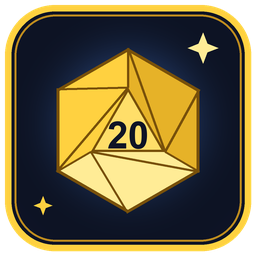
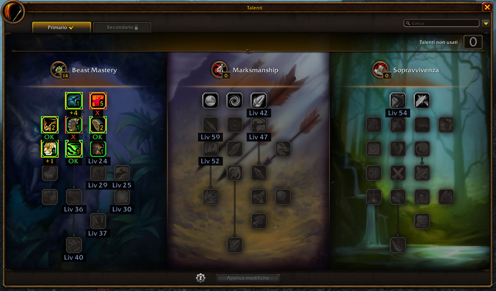
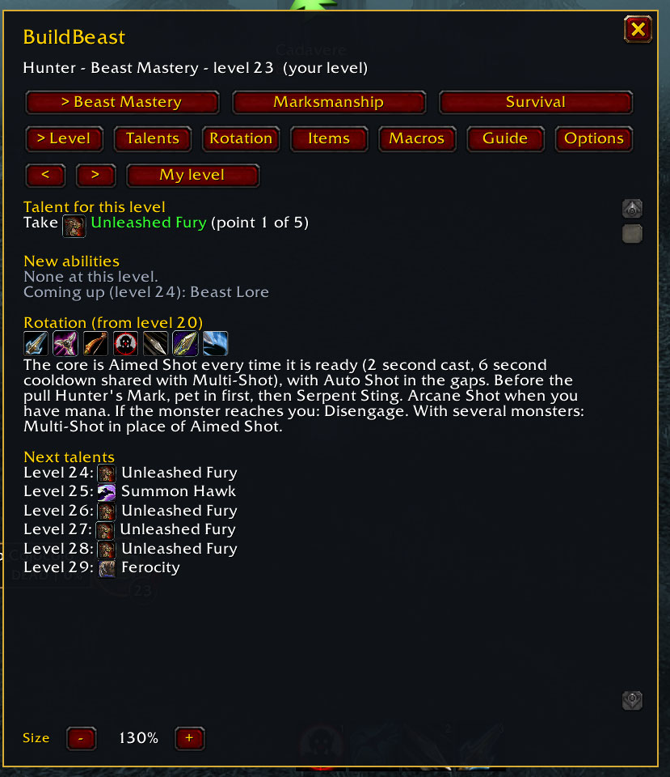
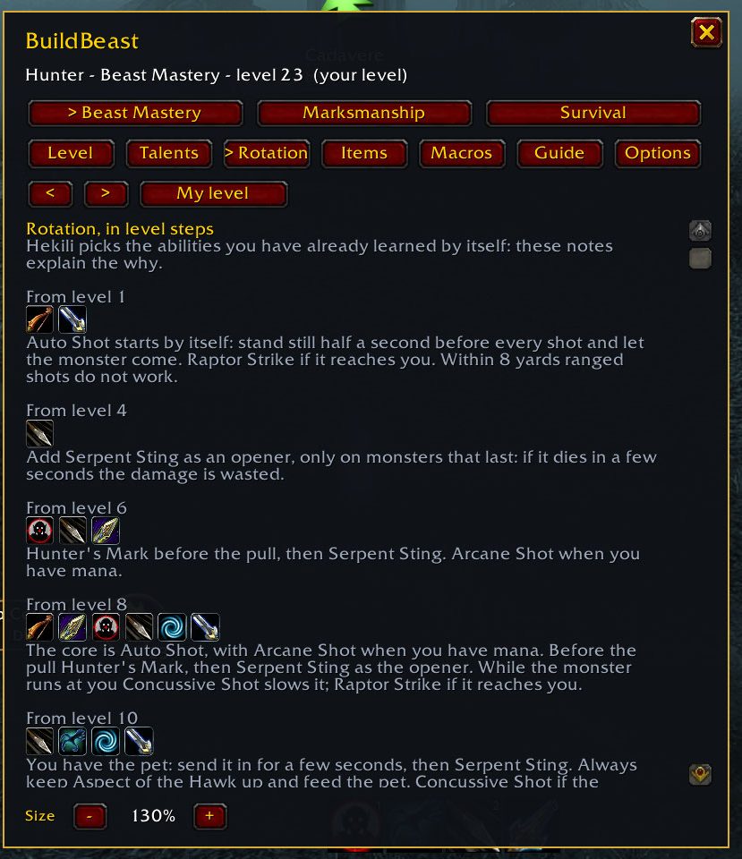
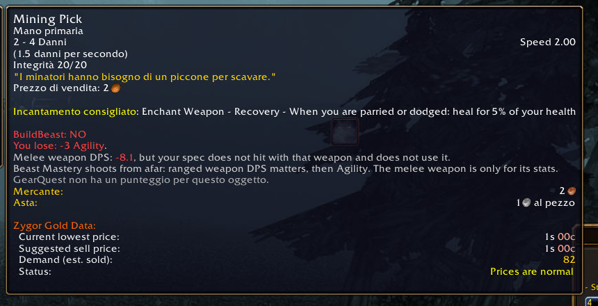
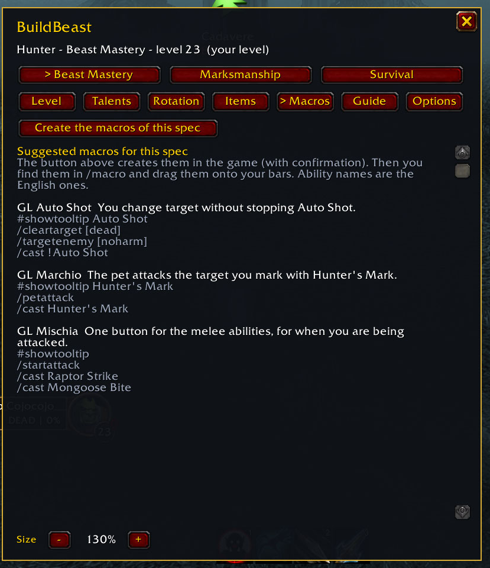
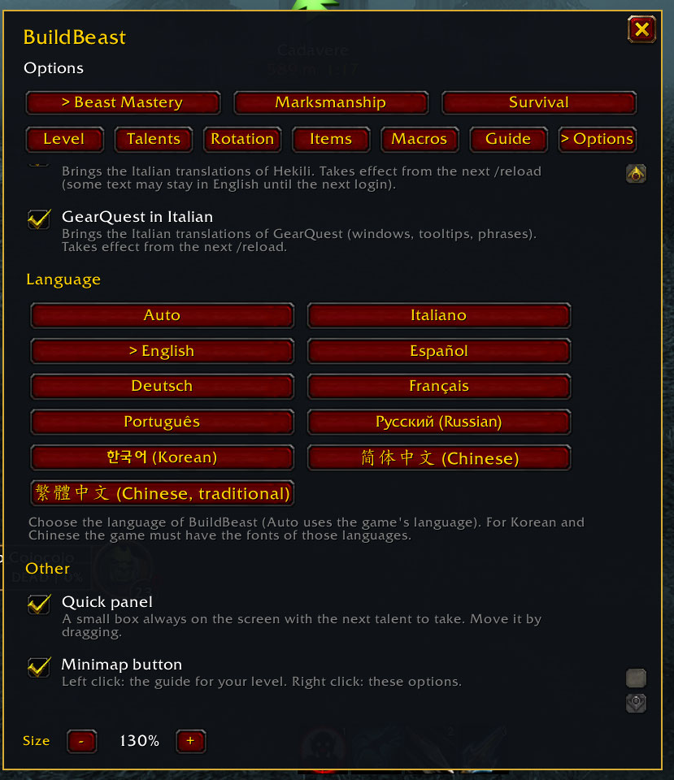

# BuildBeast

**Leveling guide 1-60 for every class and spec of WoW Forever** — made by Sairiin.

Download: see [Releases](../../releases/latest) · also on CurseForge and WoWInterface.

> **License: All Rights Reserved.** You may install and use the addon for your own play. Copying, modifying, translating, redistributing or reusing the code or its texts is not allowed without written permission. See [LICENSE](LICENSE).

<b>English</b>

Know exactly what to do at every level. BuildBeast tells you which talent to take, which abilities you get and how to use them, which item to wear, and lights up the right buttons on your bars.

**Features**
- **Talent plan** for all 51 points, with colored marks on the game's own talent window (gold +N = points to spend, green OK = on plan, blue = coming later, red X = too many).
- **Level tab**: the talent to take now, new abilities with icons, how to use them, next talents.
- **Rotation notes by level range**; with Hekili installed the right buttons glow (gold = now, blue = next) and cooldown numbers appear on the buttons.
- **Item verdict** in the tooltip: YES / NO / SIMILAR against what you wear, with the reason, green and red stats, the suggested enchant and arrows on bag icons. Threshold adjustable.
- **Macros** for every spec, created in the game with one button.
- **Quick panel** with the next talent and a message at every level up.
- **10 languages** (it, en, es, de, fr, pt, ru, ko, zh-CN, zh-TW), auto-detected, changeable in Options. Resizable interface.
- All 9 classes, 27 specs (Holy Paladin: coming soon). Optional: Hekili, GearQuest Forever.

**Install:** copy the `BuildBeast` folder into `Interface/AddOns`, restart the game. Open with the minimap button or `/bb`.

Made by **Sairiin**. © 2026 Sairiin — All Rights Reserved. Copying, modifying or redistributing the code is not allowed.

<b>Italiano</b>

Sai sempre cosa fare a ogni livello. BuildBeast ti dice quale talento prendere, quali abilità ricevi e come usarle, quale oggetto indossare, e illumina i tasti giusti sulle barre.

**Funzioni**
- **Piano dei talenti** per tutti i 51 punti, con segni colorati sul pannello dei talenti del gioco (+N oro = punti da spendere, OK verde = a posto, blu = in arrivo, X rossa = troppi punti).
- **Scheda Livello**: il talento da prendere ora, le abilità nuove con le icone, come usarle, i prossimi talenti.
- **Rotazione per fasce di livello**; con Hekili i tasti giusti si illuminano (oro = ora, blu = prossimo) e compaiono i numeri di ricarica.
- **Parere sugli oggetti** nel tooltip: SÌ / NO / SIMILE rispetto a quello che indossi, con il perché, statistiche verdi e rosse, incantamento suggerito e frecce sulle icone della borsa. Soglia regolabile.
- **Macro** per ogni spec, create nel gioco con un bottone.
- **Pannello rapido** con il prossimo talento e un messaggio a ogni livello.
- **10 lingue**, rilevate in automatico e cambiabili nelle Opzioni. Interfaccia ridimensionabile.
- Tutte le 9 classi, 27 spec (Paladino Holy: in arrivo). Facoltativi: Hekili, GearQuest Forever.

**Installazione:** copia la cartella `BuildBeast` in `Interface/AddOns`, riavvia il gioco. Si apre dal pulsante sulla minimappa o con `/bb`.

Realizzato da **Sairiin**. © 2026 Sairiin — Tutti i diritti riservati. È vietato copiare, modificare o ridistribuire il codice.

<b>Español</b>

Sabe siempre qué hacer en cada nivel. BuildBeast te dice qué talento elegir, qué habilidades recibes y cómo usarlas, qué objeto llevar, e ilumina los botones correctos en tus barras.

**Funciones**
- **Plan de talentos** de los 51 puntos, con marcas de colores en la propia ventana de talentos del juego (+N oro = puntos que gastar, OK verde = en orden, azul = más adelante, X roja = demasiados).
- **Pestaña Nivel**: el talento que elegir ahora, habilidades nuevas con iconos, cómo usarlas, próximos talentos.
- **Rotación por tramos de nivel**; con Hekili los botones correctos brillan (oro = ahora, azul = siguiente) y aparecen los números de reutilización.
- **Opinión sobre objetos** en el tooltip: SÍ / NO / PARECIDO respecto a lo que llevas, con el porqué, estadísticas en verde y rojo, encantamiento sugerido y flechas en los iconos de la bolsa. Umbral ajustable.
- **Macros** para cada especialización, creadas en el juego con un botón.
- **Panel rápido** con el próximo talento y un mensaje al subir de nivel.
- **10 idiomas**, detección automática y cambio en Opciones. Interfaz redimensionable.
- 9 clases, 27 especializaciones (Paladín Holy: próximamente). Opcional: Hekili, GearQuest Forever.

**Instalación:** copia la carpeta `BuildBeast` en `Interface/AddOns` y reinicia el juego. Se abre con el botón del minimapa o con `/bb`.

Creado por **Sairiin**. © 2026 Sairiin — Todos los derechos reservados. Queda prohibido copiar, modificar o redistribuir el código.

<b>Deutsch</b>

Du weißt auf jeder Stufe, was zu tun ist. BuildBeast sagt dir, welches Talent du nimmst, welche Fähigkeiten du bekommst und wie du sie einsetzt, welchen Gegenstand du anlegst – und lässt die richtigen Tasten auf deinen Leisten leuchten.

**Funktionen**
- **Talentplan** für alle 51 Punkte, mit farbigen Markierungen direkt im Talentfenster des Spiels (Gold +N = Punkte ausgeben, grünes OK = im Plan, Blau = kommt später, rotes X = zu viele).
- **Reiter Stufe**: das Talent für jetzt, neue Fähigkeiten mit Symbolen, wie man sie nutzt, nächste Talente.
- **Rotation nach Stufenabschnitten**; mit Hekili leuchten die richtigen Tasten (Gold = jetzt, Blau = als Nächstes) und Abklingzeit-Zahlen erscheinen.
- **Gegenstandsurteil** im Tooltip: JA / NEIN / ÄHNLICH im Vergleich zu deiner Ausrüstung, mit Begründung, grünen und roten Werten, empfohlener Verzauberung und Pfeilen auf den Taschensymbolen. Schwelle einstellbar.
- **Makros** für jede Spezialisierung, mit einem Klick im Spiel erstellt.
- **Schnellfeld** mit dem nächsten Talent und einer Nachricht bei jedem Stufenaufstieg.
- **10 Sprachen**, automatisch erkannt, in den Optionen änderbar. Skalierbare Oberfläche.
- 9 Klassen, 27 Spezialisierungen (Heilig-Paladin: bald). Optional: Hekili, GearQuest Forever.

**Installation:** Ordner `BuildBeast` nach `Interface/AddOns` kopieren, Spiel neu starten. Öffnen per Minimap-Button oder `/bb`.

Erstellt von **Sairiin**. © 2026 Sairiin — Alle Rechte vorbehalten. Das Kopieren, Ändern oder Weitergeben des Codes ist untersagt.

<b>Français</b>

Sachez toujours quoi faire à chaque niveau. BuildBeast vous dit quel talent prendre, quelles capacités vous recevez et comment les utiliser, quel objet porter, et illumine les bonnes touches sur vos barres.

**Fonctionnalités**
- **Plan de talents** pour les 51 points, avec des marques colorées sur la fenêtre de talents du jeu (+N or = points à dépenser, OK vert = conforme, bleu = plus tard, X rouge = trop de points).
- **Onglet Niveau** : le talent à prendre maintenant, les nouvelles capacités avec leurs icônes, comment les utiliser, les prochains talents.
- **Rotation par paliers de niveau** ; avec Hekili, les bonnes touches s'illuminent (or = maintenant, bleu = suivante) et les chiffres de recharge s'affichent.
- **Avis sur les objets** dans l'infobulle : OUI / NON / SIMILAIRE par rapport à ce que vous portez, avec la raison, caractéristiques en vert et rouge, enchantement suggéré et flèches sur les icônes des sacs. Seuil réglable.
- **Macros** pour chaque spécialisation, créées dans le jeu en un clic.
- **Panneau rapide** avec le prochain talent et un message à chaque montée de niveau.
- **10 langues**, détection automatique, modifiable dans les Options. Interface redimensionnable.
- 9 classes, 27 spécialisations (Paladin Sacré : bientôt). Facultatif : Hekili, GearQuest Forever.

**Installation :** copiez le dossier `BuildBeast` dans `Interface/AddOns`, relancez le jeu. Ouvrez-le avec le bouton de la minicarte ou `/bb`.

Réalisé par **Sairiin**. © 2026 Sairiin — Tous droits réservés. Il est interdit de copier, modifier ou redistribuer le code.

<b>Português</b>

Saiba sempre o que fazer em cada nível. O BuildBeast diz qual talento escolher, que habilidades você recebe e como usá-las, qual item vestir, e ilumina os botões certos nas suas barras.

**Recursos**
- **Plano de talentos** dos 51 pontos, com marcas coloridas na própria janela de talentos do jogo (+N ouro = pontos a gastar, OK verde = no plano, azul = mais adiante, X vermelho = pontos demais).
- **Aba Nível**: o talento a escolher agora, habilidades novas com ícones, como usá-las, próximos talentos.
- **Rotação por faixas de nível**; com o Hekili os botões certos brilham (ouro = agora, azul = próximo) e aparecem os números de recarga.
- **Opinião sobre itens** na dica de ferramenta: SIM / NÃO / PARECIDO em relação ao que você veste, com o motivo, atributos em verde e vermelho, encantamento sugerido e setas nos ícones da bolsa. Limite ajustável.
- **Macros** para cada especialização, criadas no jogo com um botão.
- **Painel rápido** com o próximo talento e uma mensagem a cada nível.
- **10 idiomas**, detectados automaticamente e alteráveis nas Opções. Interface redimensionável.
- 9 classes, 27 especializações (Paladino Sagrado: em breve). Opcional: Hekili, GearQuest Forever.

**Instalação:** copie a pasta `BuildBeast` para `Interface/AddOns` e reinicie o jogo. Abra pelo botão do minimapa ou `/bb`.

Feito por **Sairiin**. © 2026 Sairiin — Todos os direitos reservados. É proibido copiar, modificar ou redistribuir o código.

<b>Русский</b>

Всегда знайте, что делать на каждом уровне. BuildBeast подсказывает, какой талант взять, какие умения вы получаете и как ими пользоваться, какой предмет надеть, и подсвечивает нужные кнопки на ваших панелях.

**Возможности**
- **План талантов** на все 51 очко, с цветными отметками прямо в окне талантов игры (золотой +N = очки к трате, зелёный OK = по плану, синий = позже, красный X = слишком много).
- **Вкладка «Уровень»**: талант для взятия сейчас, новые умения со значками, как ими пользоваться, следующие таланты.
- **Ротация по этапам уровней**; с Hekili нужные кнопки подсвечиваются (золотой = сейчас, синий = следующая) и появляются цифры перезарядки.
- **Оценка предметов** в подсказке: ДА / НЕТ / ПОХОЖЕ по сравнению с надетым, с причиной, зелёными и красными характеристиками, предлагаемыми чарами и стрелками на значках в сумках. Порог настраивается.
- **Макросы** для каждой специализации, создаются в игре одной кнопкой.
- **Быстрая панель** со следующим талантом и сообщение при каждом новом уровне.
- **10 языков**, определяются автоматически, меняются в Настройках. Масштабируемый интерфейс.
- 9 классов, 27 специализаций (Свет у паладина: скоро). Дополнительно: Hekili, GearQuest Forever.

**Установка:** скопируйте папку `BuildBeast` в `Interface/AddOns` и перезапустите игру. Открывается кнопкой у миникарты или `/bb`.

Создано **Sairiin**. © 2026 Sairiin — Все права защищены. Копировать, изменять и распространять код запрещено.

<b>한국어</b>

레벨마다 무엇을 해야 하는지 항상 알 수 있습니다. BuildBeast는 어떤 특성을 고를지, 어떤 기술을 얻고 어떻게 쓰는지, 어떤 아이템을 착용할지 알려 주고 행동 단축바의 알맞은 버튼을 밝혀 줍니다.

**기능**
- 게임의 특성 창에 색깔 표시가 나타나는 **51포인트 특성 계획** (금색 +N = 쓸 포인트, 초록 OK = 계획대로, 파랑 = 나중에, 빨강 X = 포인트 과다).
- **레벨 탭**: 지금 고를 특성, 아이콘이 붙은 새 기술, 사용법, 다음 특성.
- **레벨 구간별 연계**: Hekili가 있으면 알맞은 버튼이 빛나고(금색 = 지금, 파랑 = 다음) 재사용 대기시간 숫자가 표시됩니다.
- 툴팁의 **아이템 평가**: 착용 중인 것과 비교해 예 / 아니오 / 비슷함, 이유, 초록·빨강 능력치, 추천 마법부여, 가방 아이콘 화살표. 기준값 조절 가능.
- 전문화별 **매크로**를 버튼 하나로 게임에 생성.
- 다음 특성을 보여 주는 **빠른 패널**과 레벨업 때마다 메시지.
- **10개 언어**, 자동 감지, 설정에서 변경. 크기 조절 가능한 인터페이스.
- 9개 직업, 27개 전문화 (성기사 신성: 준비 중). 선택: Hekili, GearQuest Forever.

**설치:** `BuildBeast` 폴더를 `Interface/AddOns`에 복사하고 게임을 다시 시작하세요. 미니맵 버튼 또는 `/bb`로 엽니다.

제작: **Sairiin**. © 2026 Sairiin — 모든 권리 보유. 코드의 복사, 수정, 재배포를 금지합니다.

<b>简体中文</b>

每一级都知道该做什么。BuildBeast 告诉你该选哪个天赋、会获得哪些技能以及如何使用、该穿哪件物品，并在你的动作条上点亮正确的按键。

**功能**
- **51个天赋点的计划**，在游戏自带的天赋窗口上显示彩色标记（金色 +N = 要花的点数，绿色 OK = 符合计划，蓝色 = 稍后，红色 X = 点数过多）。
- **等级标签**：现在要选的天赋、带图标的新技能、用法、接下来的天赋。
- **按等级阶段的输出循环**；有 Hekili 时正确的按键会亮起（金色 = 现在，蓝色 = 下一个），并显示冷却数字。
- 提示框中的**物品评价**：与你穿戴的相比为 是 / 否 / 相近，附原因、绿色和红色属性、推荐附魔以及背包图标上的箭头。阈值可调。
- 为每个专精提供**宏**，一键在游戏中创建。
- 显示下一个天赋的**快捷面板**，并在每次升级时提示。
- **10种语言**，自动检测，可在选项中更改。界面可缩放。
- 9个职业，27个专精（神圣圣骑士：即将推出）。可选：Hekili、GearQuest Forever。

**安装：** 将 `BuildBeast` 文件夹复制到 `Interface/AddOns`，重启游戏。通过小地图按钮或 `/bb` 打开。

作者：**Sairiin**。© 2026 Sairiin — 保留所有权利。禁止复制、修改或再分发代码。

<b>繁體中文</b>

每一級都知道該做什麼。BuildBeast 告訴你該選哪個天賦、會獲得哪些技能以及如何使用、該穿哪件物品，並在你的動作列上點亮正確的按鍵。

**功能**
- **51個天賦點的計劃**，在遊戲內建的天賦視窗上顯示彩色標記（金色 +N = 要花的點數，綠色 OK = 符合計劃，藍色 = 稍後，紅色 X = 點數過多）。
- **等級分頁**：現在要選的天賦、帶圖示的新技能、用法、接下來的天賦。
- **依等級階段的輸出循環**；有 Hekili 時正確的按鍵會亮起（金色 = 現在，藍色 = 下一個），並顯示冷卻數字。
- 提示框中的**物品評價**：與你穿戴的相比為 是 / 否 / 相近，附原因、綠色和紅色屬性、推薦附魔以及背包圖示上的箭頭。閾值可調。
- 為每個專精提供**巨集**，一鍵在遊戲中建立。
- 顯示下一個天賦的**快捷面板**，並在每次升級時提示。
- **10種語言**，自動偵測，可在選項中更改。介面可縮放。
- 9個職業，27個專精（神聖聖騎士：即將推出）。選用：Hekili、GearQuest Forever。

**安裝：** 將 `BuildBeast` 資料夾複製到 `Interface/AddOns`，重新啟動遊戲。透過小地圖按鈕或 `/bb` 開啟。

作者：**Sairiin**。© 2026 Sairiin — 保留所有權利。禁止複製、修改或再散布程式碼。

